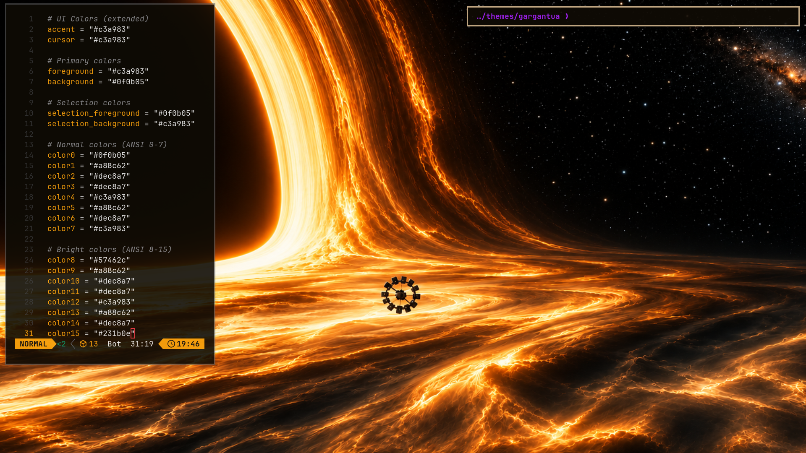

# GARGANTUA — Cinematic Edition · Omarchy Theme

**Unofficial cinematic fan theme inspired by *Interstellar*.** Nine AI-generated space-themed wallpapers and the [Golden Brown Omarchy palette](https://github.com/atif-1402/omarchy-golden-brown-theme). Not associated with or endorsed by the film's creators, studio, or other rightsholders.



## Install

```bash
omarchy theme install https://github.com/YOUR_GITHUB_USERNAME/omarchy-gargantua-theme
omarchy theme set gargantua
```

Replace `YOUR_GITHUB_USERNAME` with the account that published the repo. From the Omarchy wallpaper selector, choose the first image to get the default Gargantua view.

## Wallpapers

| # | Scene | File |
|---|---|---|
| 00 | Gargantua with tiny Endurance · main | `00-gargantua-endurance-main.png` |
| 01 | Cooper's farmhouse at sunset | `01-coopers-farmhouse.png` |
| 02 | Endurance approaching Saturn | `02-saturn-approach.png` |
| 03 | Endurance spacecraft close-up | `03-endurance-closeup.png` |
| 04 | Miller's Planet ocean wave | `04-millers-planet.png` |
| 05 | Mann's Planet ice world | `05-manns-planet.png` |
| 06 | TARS cockpit | `06-tars-cockpit-first.png` |
| 07 | Tesseract library | `07-tesseract.png` |
| 08 | Endurance, small celestial body and Gargantua · alternate | `08-gargantua-original-alternate.png` |

The intended main wallpaper is `00`; all nine images are stored in `backgrounds/` and retain the approved cinematic sequence.

## Color palette

| Role | Color |
|---|---|
| Background | `#0f0b05` |
| Foreground / Accent | `#c3a983` |
| Border / Muted gold | `#57462c` |
| Cream | `#dec8a7` |

The palette derives from the [Golden Brown Omarchy Theme](https://github.com/atif-1402/omarchy-golden-brown-theme), copyright 2026 anom538, under the MIT license. The complete upstream notice is preserved in [`LICENSES/GOLDEN-BROWN-MIT.txt`](LICENSES/GOLDEN-BROWN-MIT.txt).

## Art, rights and non-affiliation

This is an **unofficial fan project**. The wallpapers are AI-generated images inspired by a copyrighted film and visually evoke recognizable settings, spacecraft, or characters. They are not presented as film frames. **AI generation and this disclaimer do not establish that all third-party rights are cleared.** Any rightsholder concerns can be reported through this repository's Issues page.

The upstream MIT license applies to the Golden Brown-derived palette code/material, **not** to any film imagery, trademarks, or third-party material. There is no blanket MIT or Creative Commons license for the wallpapers in `backgrounds/` or the screenshot `preview.png`. See [`ARTWORK-NOTICE.md`](ARTWORK-NOTICE.md).

## Notes

- The preview is a real 1920×1080 desktop screenshot, not a mockup.
- This theme contains colors and wallpapers; installation does **not** automatically add TARS Mission Control, tmux, custom keybindings, shell prompt colors, or terminal transparency.
- Transparent Foot terminals and other local settings vary by user. Personal overrides in `~/.config/foot/foot.ini` can take precedence over theme colors.
- [TARS Mission Control] is an optional, separate companion project, not included here.

Built and tested locally on Omarchy, with the final public GitHub installation and registry validation to be confirmed after publication.
